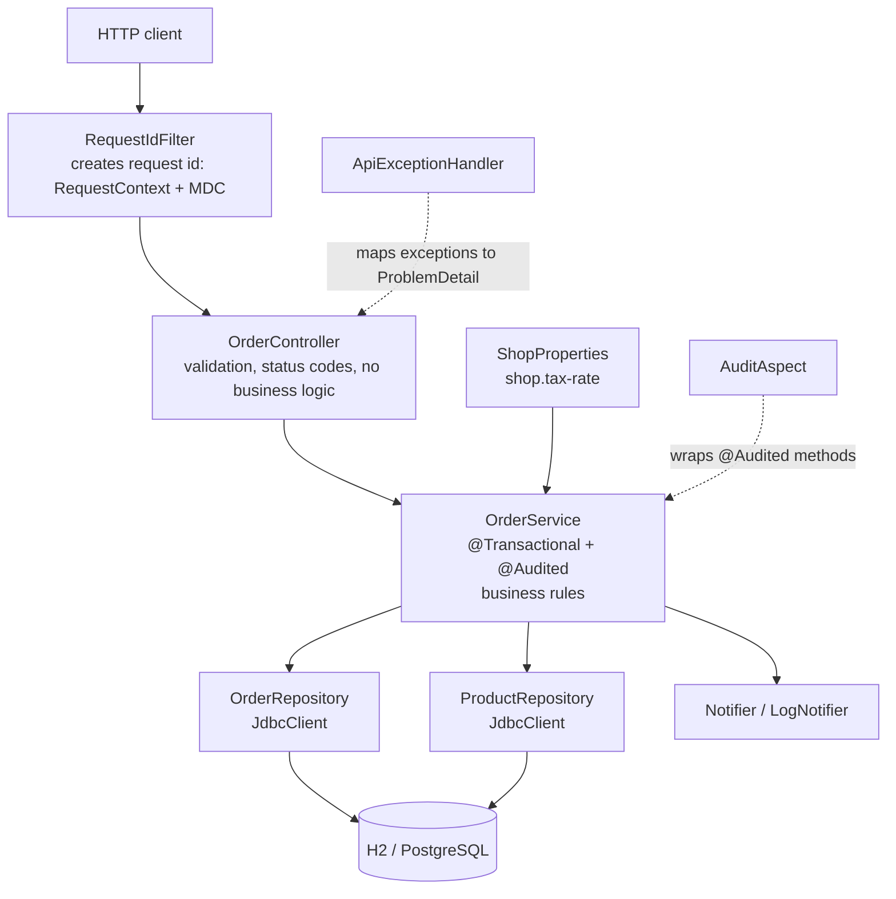
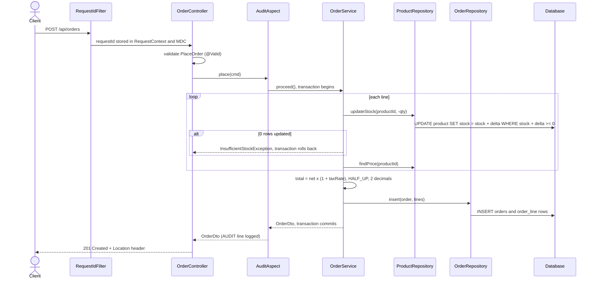

## Challenge: layered order management

Customers place orders with several lines. Stock is reserved atomically for all lines or none, orders can be listed with pagination and cancelled (which returns the stock). The code follows the layered architecture and is covered by tests at every layer.

### Running it

| Mode | Command | Database |
|---|---|---|
| Default | `./mvnw spring-boot:run` | in-memory H2, `schema.sql` + `data.sql` |
| `test` profile | used by the tests (`@ActiveProfiles("test")`) | in-memory H2, `schema.sql` + `data-test.sql` |
| `prod` profile | see below | PostgreSQL via Docker |

Tests: `./mvnw -q verify` (needs only JDK 25, no Docker, no environment variables).

**PostgreSQL (`prod` profile)**

1. Copy `.env.example` to `.env` and set `DB_PASSWORD` (`.env` is git-ignored, no password is committed).
2. `docker compose up -d` starts PostgreSQL 17 (database `shop`, user `shop`).
3. `./mvnw spring-boot:run -Dspring-boot.run.profiles=prod`

`schema.sql` uses `GENERATED BY DEFAULT AS IDENTITY`, which both H2 and PostgreSQL accept. With PostgreSQL, the demo data in `data.sql` is inserted on every start; run `docker compose down -v` to reset the database.

### API

| Method and path | Result |
|---|---|
| `POST /api/orders` | `201 Created` + `Location: /api/orders/{id}` |
| `GET /api/orders/{id}` | order with its lines, `404` if unknown |
| `GET /api/orders?customerId=&status=&page=&size=` | `{content, page, size, totalElements}` (page from 0, size 1 to 100) |
| `POST /api/orders/{id}/cancel` | only `NEW` orders, otherwise `409` |

Errors are returned as `ProblemDetail` (`application/problem+json`): `409` for insufficient stock or a non-cancellable order, `404` for an unknown order, `400` for validation errors or a duplicate product. A recorded session is in `api-session.md`.

### Architecture

Packages are organised by feature (`order`, `product`) plus cross-cutting packages (`audit`, `config`, `notify`, `web`).



| Layer | Classes | Responsibility |
|---|---|---|
| Web | `OrderController`, `ApiExceptionHandler`, `RequestIdFilter` | HTTP only: JSON in and out, `@Valid`, status codes, error mapping |
| Service | `OrderService` | business rules, pricing, transaction boundary |
| Repository | `OrderRepository`, `ProductRepository` | SQL with `JdbcClient` and bound parameters, no business logic |
| Cross-cutting | `@Audited`, `AuditAspect`, `RequestContext` (request-scoped) | audit log and request id on every audited call |
| Config | `ShopProperties`, profiles | `shop.tax-rate`, H2 or PostgreSQL |

### Request flow: placing an order



### Where the transaction boundary is, and why

The boundary is the **service method**: `OrderService.place` and `OrderService.cancel` are `@Transactional` (and `get` / `list` are `@Transactional(readOnly = true)`). Nothing in the controllers or repositories is transactional.

One business operation spans several repository calls: `place` decrements the stock of every line and then inserts the order and its lines. If each repository call committed on its own, a failure on the second line would leave the first line's stock already taken. Only the service knows where a business operation starts and ends, so only the service can make it all-or-nothing. A controller knows nothing about the database, and a repository only sees one statement at a time.

When a `RuntimeException` such as `InsufficientStockException` leaves `place`, Spring rolls the whole transaction back, so stock decremented for earlier lines is restored and no order row is written. The stock check itself is a single conditional statement (`UPDATE ... WHERE stock + :delta >= 0`, checking the affected-row count), so two concurrent orders cannot both pass a separate "is there enough stock" check and oversell, and no explicit locking is needed. `OrderEndToEndTest.failedOrderRollsBackEverything` proves the rollback: a 409 leaves every product's stock and the orders table unchanged.

### Exception translation

The repositories are `@Repository` beans, so Spring translates the database driver's `SQLException` into its own unchecked, database-independent `DataAccessException` hierarchy. The service and controller never see H2 or PostgreSQL error codes. For example, an order for an unknown `customerId` violates a foreign key and surfaces as `DataIntegrityViolationException`, which `ApiExceptionHandler` turns into a `400` response with a generic message (no SQL details leak to the client).

### Audit log and request id

Every request gets an 8-character id from `RequestIdFilter`. It is stored in a `@RequestScope` bean (`RequestContext`) and in the logging MDC, so every log line of that request shows it (`[%X{requestId}]`) and it is returned in the `X-Request-Id` response header. `AuditAspect` wraps methods annotated with `@Audited` (`place`, `cancel`) and logs the method, request id, arguments, result or failure and duration, for example:

```
AUDIT OrderService.place requestId=2c5b85d5 args=[PlaceOrder[...]] result=OrderDto[id=1, status=NEW, total=120.98, ...] (3 ms)
```

### Tests

| Level | Class | What it checks |
|---|---|---|
| Unit (no Spring) | `OrderServiceTest` | tax and `HALF_UP` rounding, duplicate products, insufficient stock, cancel rules (mocked repositories) |
| `@JdbcTest` | `RepositoryTest` | conditional stock update, price lookup, insert and load, pagination and filters |
| `@WebMvcTest` | `OrderControllerTest` | 201 + `Location`, 400 validation, 404, 409 mappings |
| End to end | `OrderEndToEndTest` | `@SpringBootTest(RANDOM_PORT)` with `RestTestClient`: place, check stock, cancel, check stock again; a failed order leaves stock untouched; pagination |

### Known limitations

- Two simultaneous cancel requests for the same order could both pass the `NEW` check and restore stock twice. Making the status update conditional in SQL (`WHERE status = 'NEW'`) would close this.
- An order line for a product that does not exist is reported as insufficient stock (409), not 404.
