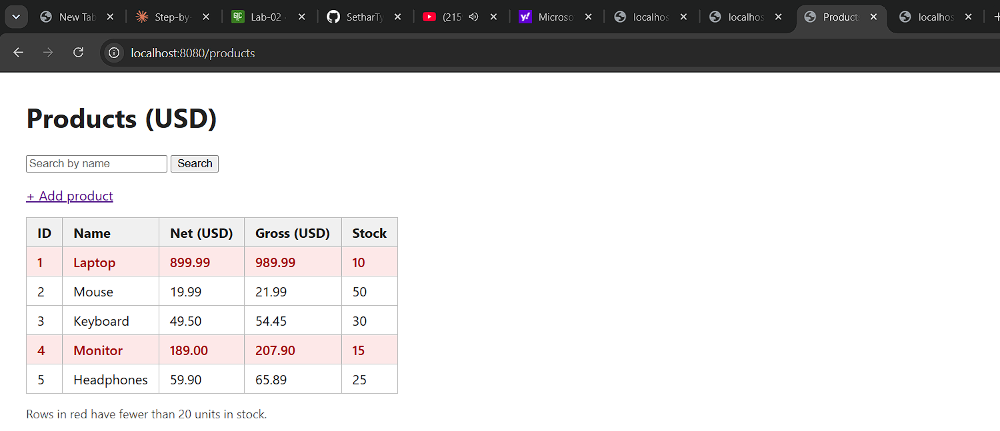
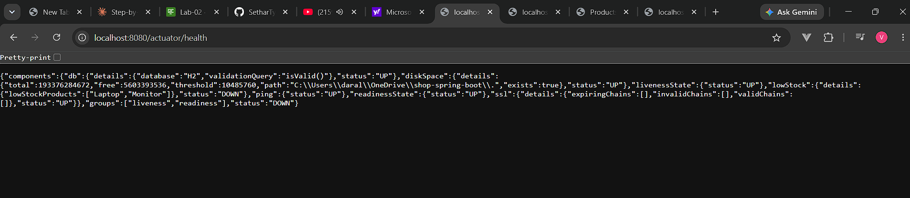
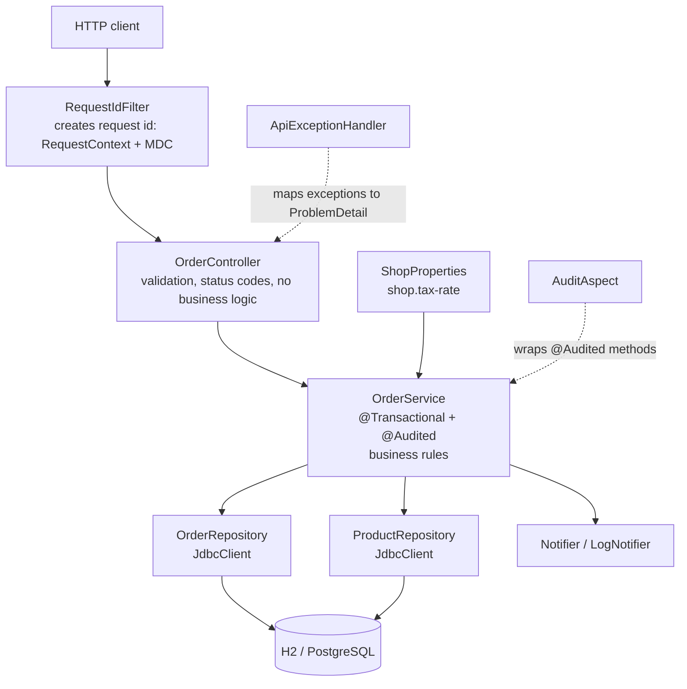
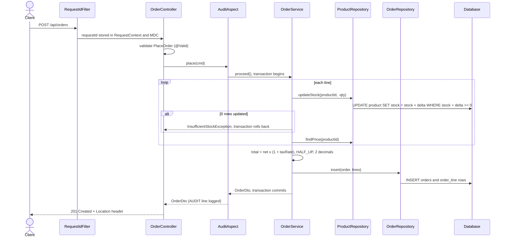

# Lab 2: Spring Boot shop project

## Task 1: Bootstrapping with Maven and Spring Boot

1. Understanding pom.xml

  <parent>
    <groupId>org.springframework.boot</groupId>
    <artifactId>spring-boot-starter-parent</artifactId>
    <version>4.1.1</version>
    <relativePath/> <!-- lookup parent from repository -->
  </parent>

- What does the `<parent>` give me?

  The parent is `spring-boot-starter-parent` 4.1.1. My project inherits from it. It gives me:
  - **Dependency management**: a list of library versions (Spring, Jackson, Tomcat, HikariCP, H2, and so on) that were tested to work together.
  - **Build defaults**: UTF-8 encoding, the Java version from `<java.version>` (25), and compiler settings.
  - **Plugin setup**: `spring-boot-maven-plugin` is already configured.

- Why do the starters have no `<version>`?

  The parent has a `<dependencyManagement>` section, which works like a price list. When Maven sees a dependency without a version, it looks the version up in that list. This keeps all libraries on matching versions, so they do not clash. The same is true for `h2` and the plugin.

- What does `spring-boot-maven-plugin` do at `package` time?

  It runs the `repackage` goal. The normal small jar becomes one executable "fat jar": - my classes go in `BOOT-INF/classes` - all dependency jars go in `BOOT-INF/lib` - a launcher is added, so `java -jar` can start the app - the original jar is kept as `*.jar.original`

Dependency tree (first level)
Command: `./mvnw dependency:tree`

```
edu.itc.se:shop:jar:0.0.1-SNAPSHOT
+- org.springframework.boot:spring-boot-h2console:jar:4.1.1:compile
+- org.springframework.boot:spring-boot-starter-actuator:jar:4.1.1:compile
+- org.springframework.boot:spring-boot-starter-aspectj:jar:4.1.1:compile
+- org.springframework.boot:spring-boot-starter-jdbc:jar:4.1.1:compile
+- org.springframework.boot:spring-boot-starter-validation:jar:4.1.1:compile
+- org.springframework.boot:spring-boot-starter-webmvc:jar:4.1.1:compile
+- org.springframework.boot:spring-boot-devtools:jar:4.1.1:runtime (optional)
+- com.h2database:h2:jar:2.4.240:runtime
+- org.springframework.boot:spring-boot-starter-actuator-test:jar:4.1.1:test
+- org.springframework.boot:spring-boot-starter-jdbc-test:jar:4.1.1:test
+- org.springframework.boot:spring-boot-starter-validation-test:jar:4.1.1:test
\- org.springframework.boot:spring-boot-starter-webmvc-test:jar:4.1.1:test
```

2. Running the app

Command: `./mvnw spring-boot:run`

```
curl.exe -i "http://localhost:8080/hello?name=Makara"
HTTP/1.1 200
Content-Type: application/json

{"message":"Hello, Makara!","at":"2026-10-28T11:29:54.847537100Z"}
```

DevTools: after I changed the message to "Hi, " and saved, the app restarted by itself and the response became `Hi, Makara!`.

3. Running with spring-boot:run and DevTools

I ran `./mvnw spring-boot:run` and changed the message from "Hello" to "Hi" while it was running. The log showed
`Restarting due to 2 class path changes`, and the next call returned `"Hi, Ann!"`. DevTools restarted the app
automatically (about 0.2 seconds).
4. Package and run the jar

`./mvnw -q package`, then `java -jar target/shop-0.0.1-SNAPSHOT.jar --server.port=9090`.
`/hello` answered on port 9090.

The jar is about 28 MB (29,757,103 bytes). My own code is only a few KB. The rest is a "fat jar":
spring-boot-maven-plugin copies every dependency (embedded Tomcat, Spring MVC, Jackson, HikariCP, H2, Actuator)
into BOOT-INF/lib. Because the server is inside the jar, `java -jar` starts the whole app by itself.

5. Actuator and auto-configuration
`GET /actuator/health` returns `{"groups":["liveness","readiness"],"status":"UP"}`.

I started the jar with `--debug` and searched the condition evaluation report. DataSourceAutoConfiguration
matched because of this line:

```
@ConditionalOnClass found required classes 'javax.sql.DataSource',
'org.springframework.jdbc.datasource.embedded.EmbeddedDatabaseType' (OnClassCondition)
```
Spring Boot found the JDBC and H2 classes on the classpath, so it configured a data source (a HikariCP pool)
automatically, without any database code from me.

6. Gradle bonus

I generated the same project with `type=gradle-project-kotlin` into the sibling folder `shop-gradle`
and ran `.\gradlew bootRun`. It started on port 8080 and `/actuator/health` returned `UP`.
Only the wrapper (`gradlew`, `gradlew.bat`, `gradle/wrapper`) and the source files are committed.
`.gradle/` and `build/` are ignored by `.gitignore`.

## Task 2: IoC, Dependency Injection and Bean Lifecycle

### What I built

```
edu.itc.shop
├── config/   AppConfig (@Bean Clock), StartupRunner (CommandLineRunner)
└── service/  Notifier, EmailNotifier, SmsNotifier, ConsoleNotifier,
              WelcomeService, ReportBuilder
```

`WelcomeServiceTest` is a plain JUnit test with no Spring context.

### Dependency resolution

| Parameter | Rule | Injected bean |
|---|---|---|
| `Notifier defaultNotifier` | by type, then `@Primary` | `EmailNotifier` |
| `@Qualifier("smsNotifier") Notifier` | qualifier = bean name | `SmsNotifier` |
| `Clock clock` | by type (one candidate) | `@Bean` in `AppConfig` |

All beans use constructor injection with `final` fields; there is no field injection.
`Clock` comes from a `@Bean` method because it is a JDK class that cannot carry `@Service`.

### Lifecycle

`@PostConstruct` logs "ready" at start-up; `@PreDestroy` logs "closing" on Ctrl+C.

```
EmailNotifier ready
SmsNotifier ready
<N> beans; notifiers = [emailNotifier, smsNotifier]
EMAIL to=ann text=Welcome ann! It is HH:mm:ss
SMS to=bob text=Welcome bob! It is HH:mm:ss
prototype instances differ: true
EmailNotifier closing
SmsNotifier closing
```

### Prototype scope

A singleton has one instance per container; a `prototype` bean is created on every request.
Injecting a prototype directly into a singleton would create it only once, so I inject
`ObjectProvider<ReportBuilder>` and call `getObject()`. Two calls gave different
`System.identityHashCode` values (`prototype instances differ: true`).

### Profiles and the `@Primary` rule

`ConsoleNotifier` is `@Profile("dev")` and `@Primary`.

- If `EmailNotifier` is also `@Primary` and active, the `dev` run fails with
  `NoUniqueBeanDefinitionException: more than one 'primary' bean found among candidates`.
- **Rule:** `@Primary` breaks a tie only when exactly one candidate has it. Two active `@Primary` beans make start-up fail.
- **Fix:** `@Profile("!dev")` on `EmailNotifier`.

| Profile | Active notifiers | Used by default |
|---|---|---|
| default | `emailNotifier`, `smsNotifier` | `EMAIL` |
| `dev` | `consoleNotifier`, `smsNotifier` | `CONSOLE` |

```powershell
.\mvnw.cmd spring-boot:run
.\mvnw.cmd spring-boot:run "-Dspring-boot.run.profiles=dev"
```

### Unit test without Spring

Constructor injection lets the test call `new WelcomeService(fakeNormal, fakeUrgent, Clock.fixed(...))`.
It asserts the text `Welcome ann! It is 09:15:02` and which notifier received the call.

### Checklist

- [x] Constructor injection, `final` fields, no field injection
- [x] `@Primary`, `@Qualifier`, `@Profile` each change the chosen bean
- [x] Lifecycle logs and prototype proof
- [x] `WelcomeServiceTest` passes without Spring
- [x] Tag `task-2`

## Task 3: JDBC

- Raw JDBC `findAll()`: about 22 lines. JdbcClient `findAll()`: 3 lines.
- Duplicate name insert throws: `org.springframework.dao.DuplicateKeyException`
  (subclass of `DataIntegrityViolationException`).
- Where the translation happened: H2 throws a raw `SQLException`
  (error code 23505, unique violation). JdbcClient runs on JdbcTemplate, which
  passes the SQLException to a `SQLExceptionTranslator`. That translator maps the
  database error code to Spring's own unchecked `DuplicateKeyException`.
  With raw JDBC you would get the plain `SQLException` instead.

## Task 4: REST API, Validation & Error Handling
- Controller Implementation: Exposed /api/products via ProductController with full support for filtering (?q=), ID lookups, resource creation (POST), stock updates (PATCH), and deletion (DELETE).
- Validation: Enforced via DTO records (CreateProduct) using Jakarta validation constraints (@NotBlank, @DecimalMin, @PositiveOrZero). Invalid payloads are intercepted and return a 400 Bad Request with a structured list of field errors.
- Consistent Error Handling: Implemented a global exception handler (ApiExceptionAdvice annotated with @RestControllerAdvice) that translates application exceptions (ProductNotFoundException, InsufficientStockException, DuplicateKeyException) into standardized RFC 7807 ProblemDetail responses (application/problem+json) without leaking Java stack traces.
- Testing & Transcripts: Verified via isolated @WebMvcTest slices with MockMvc. All live interactions, successful status codes (201 Created, 204 No Content), and error conditions (404 Not Found, 409 Conflict) are fully recorded in api-session.md.

## Task 5: JSP Views, Profiles, Actuator, Logging and an Aspect

### What I built

```
edu.itc.shop
├── config/   ShopProperties, PropertiesConfig, LowStockHealthIndicator
├── service/  TimingAspect
└── web/      ProductPageController, RequestIdFilter, dto/ProductRow
webapp/WEB-INF/jsp/products/   list.jsp, form.jsp
resources/   application.yml, application-dev.yml, application-prod.yml, static/css/site.css
```

### JSP views

`ProductPageController` returns the view names `products/list` and `products/form`. The prefix `/WEB-INF/jsp/`
and the suffix `.jsp` in `application.yml` (under `spring.mvc.view`) turn them into JSP files. The controller calls
`ProductService`; it has no `try/catch` and no business logic.

- All output is escaped with `<c:out>`, so a product name cannot inject HTML or a script.
- After a successful `POST /products` the controller returns `redirect:/products` (POST-redirect-GET). A browser
  refresh then does not submit the form twice. The message "Product saved" travels as a flash attribute.
- A failed validation shows the form again with the error messages.
- The list page shows the currency, the net price and the gross price
  (gross = price x (1 + taxRate), rounded half-up, e.g. Laptop 899.99 x 1.10 = 989.99).
  Products below the stock threshold get the CSS class `low` and are shown in red.



### Profiles and typed properties

`ShopProperties` is a `@ConfigurationProperties("shop")` record with `currency`, `taxRate` and `lowStockThreshold`.
It is validated (`@NotBlank`, `@DecimalMin`, `@Min`), so the application does not start if a value is invalid.

| | dev | prod |
|---|---|---|
| Profile line | `The following 1 profile is active: "dev"` | `The following 1 profile is active: "prod"` |
| H2 console | `H2 console available at '/h2-console'. Database available at 'jdbc:h2:mem:shopdb'` | not started, `/h2-console` returns 404 |
| Log level | DEBUG (SQL and timing lines) | INFO |
| Datasource | in-memory H2 from `application.yml` | `DB_URL`, `DB_USER`, `DB_PASSWORD` environment variables |

No password is committed; in `prod` the credentials come from the environment.
Spring Boot 4 moved the H2 console into its own module, so `spring-boot-h2console` is in `pom.xml`.
Without it `/h2-console` is not registered.

```powershell
.\mvnw.cmd spring-boot:run "-Dspring-boot.run.profiles=dev"

$env:DB_URL="jdbc:h2:mem:proddb;DB_CLOSE_DELAY=-1"; $env:DB_USER="sa"; $env:DB_PASSWORD=""
.\mvnw.cmd spring-boot:run "-Dspring-boot.run.profiles=prod"
```

### Actuator

Exposed endpoints: `health`, `info`, `metrics`, `loggers`.

`LowStockHealthIndicator` reports DOWN, with the detail `lowStockProducts`, when a product has less stock than
`shop.low-stock-threshold` (set to 20). With the sample data Laptop (10) and Monitor (15) are below it, so the
whole application status is DOWN:

```
"lowStock":{"details":{"lowStockProducts":["Laptop","Monitor"]},"status":"DOWN"} ... "status":"DOWN"
```



`GET /actuator/info` returns `{"app":{"name":"shop","version":"0.0.1-SNAPSHOT"}}`. The values are filled from
the Maven project properties (`@project.artifactId@`, `@project.version@`).

### Logging with a request id

`RequestIdFilter` puts an 8-character random id into the MDC at the start of each request and removes it in a
`finally` block. The thread is reused by the pool, so without the cleanup the id would leak into the next
request. The console pattern prints it as `[%X{requestId}]`, so all lines of one request share the same id.
Lines written at start-up show `[]` because there is no HTTP request yet.

```
14:34:01.426 INFO  [8ec02d9b] e.itc.shop.web.ProductPageController : created product 6 'USB'
```

A failed validation is logged at WARN:

```
PASTE YOUR WARN LINE HERE (search the terminal for "validation failed")
```

### Timing aspect

`TimingAspect` is an `@Around` advice on all public methods of the `*Service` classes in
`edu.itc.shop.service`. It logs the method and the time in microseconds at DEBUG:

```
14:38:25.122 DEBUG [1269efb8] edu.itc.shop.service.TimingAspect : ProductService.search(..) took 83013 us
```

The first call after start-up is slow (JVM warm-up); later calls are much faster.
I changed the log level at run time, without a restart:

```
POST /actuator/loggers/edu.itc.shop.service.TimingAspect  {"configuredLevel":"OFF"}
  -> no new "took" lines after reloading /products
POST /actuator/loggers/edu.itc.shop.service.TimingAspect  {"configuredLevel":"DEBUG"}
  -> the "took" line is back; GET returns {"configuredLevel":"DEBUG","effectiveLevel":"DEBUG"}
```

## Challenge: layered order management

Customers place orders with several lines. Stock is reserved atomically for all lines or none, orders can be listed with pagination and cancelled (which returns the stock). The code follows the layered architecture and is covered by tests at every layer.

### Running it

| Mode | Command | Database |
|---|---|---|
| Default | `./mvnw spring-boot:run` | in-memory H2, `schema.sql` + `data.sql` |
| `test` profile | used by the tests (`@ActiveProfiles("test")`) | in-memory H2, `schema.sql` + `data-test.sql` |
| `prod` profile | see below | PostgreSQL via Docker |

Tests: `./mvnw -q verify` (needs only JDK 25, no Docker, no environment variables).

**PostgreSQL (`prod` profile)**

1. Copy `.env.example` to `.env` and set `DB_PASSWORD` (`.env` is git-ignored, no password is committed).
2. `docker compose up -d` starts PostgreSQL 17 (database `shop`, user `shop`).
3. `./mvnw spring-boot:run -Dspring-boot.run.profiles=prod`

`schema.sql` uses `GENERATED BY DEFAULT AS IDENTITY`, which both H2 and PostgreSQL accept. With PostgreSQL, the demo data in `data.sql` is inserted on every start; run `docker compose down -v` to reset the database.

### API

| Method and path | Result |
|---|---|
| `POST /api/orders` | `201 Created` + `Location: /api/orders/{id}` |
| `GET /api/orders/{id}` | order with its lines, `404` if unknown |
| `GET /api/orders?customerId=&status=&page=&size=` | `{content, page, size, totalElements}` (page from 0, size 1 to 100) |
| `POST /api/orders/{id}/cancel` | only `NEW` orders, otherwise `409` |

Errors are returned as `ProblemDetail` (`application/problem+json`): `409` for insufficient stock or a non-cancellable order, `404` for an unknown order, `400` for validation errors or a duplicate product. A recorded session is in `api-session.md`.

### Architecture

Packages are organised by feature (`order`, `product`) plus cross-cutting packages (`audit`, `config`, `notify`, `web`).



| Layer | Classes | Responsibility |
|---|---|---|
| Web | `OrderController`, `ApiExceptionHandler`, `RequestIdFilter` | HTTP only: JSON in and out, `@Valid`, status codes, error mapping |
| Service | `OrderService` | business rules, pricing, transaction boundary |
| Repository | `OrderRepository`, `ProductRepository` | SQL with `JdbcClient` and bound parameters, no business logic |
| Cross-cutting | `@Audited`, `AuditAspect`, `RequestContext` (request-scoped) | audit log and request id on every audited call |
| Config | `ShopProperties`, profiles | `shop.tax-rate`, H2 or PostgreSQL |

### Request flow: placing an order



### Where the transaction boundary is, and why

The boundary is the **service method**: `OrderService.place` and `OrderService.cancel` are `@Transactional` (and `get` / `list` are `@Transactional(readOnly = true)`). Nothing in the controllers or repositories is transactional.

One business operation spans several repository calls: `place` decrements the stock of every line and then inserts the order and its lines. If each repository call committed on its own, a failure on the second line would leave the first line's stock already taken. Only the service knows where a business operation starts and ends, so only the service can make it all-or-nothing. A controller knows nothing about the database, and a repository only sees one statement at a time.

When a `RuntimeException` such as `InsufficientStockException` leaves `place`, Spring rolls the whole transaction back, so stock decremented for earlier lines is restored and no order row is written. The stock check itself is a single conditional statement (`UPDATE ... WHERE stock + :delta >= 0`, checking the affected-row count), so two concurrent orders cannot both pass a separate "is there enough stock" check and oversell, and no explicit locking is needed. `OrderEndToEndTest.failedOrderRollsBackEverything` proves the rollback: a 409 leaves every product's stock and the orders table unchanged.

### Exception translation

The repositories are `@Repository` beans, so Spring translates the database driver's `SQLException` into its own unchecked, database-independent `DataAccessException` hierarchy. The service and controller never see H2 or PostgreSQL error codes. For example, an order for an unknown `customerId` violates a foreign key and surfaces as `DataIntegrityViolationException`, which `ApiExceptionHandler` turns into a `400` response with a generic message (no SQL details leak to the client).

### Audit log and request id

Every request gets an 8-character id from `RequestIdFilter`. It is stored in a `@RequestScope` bean (`RequestContext`) and in the logging MDC, so every log line of that request shows it (`[%X{requestId}]`) and it is returned in the `X-Request-Id` response header. `AuditAspect` wraps methods annotated with `@Audited` (`place`, `cancel`) and logs the method, request id, arguments, result or failure and duration, for example:

```
AUDIT OrderService.place requestId=2c5b85d5 args=[PlaceOrder[...]] result=OrderDto[id=1, status=NEW, total=120.98, ...] (3 ms)
```

### Tests

| Level | Class | What it checks |
|---|---|---|
| Unit (no Spring) | `OrderServiceTest` | tax and `HALF_UP` rounding, duplicate products, insufficient stock, cancel rules (mocked repositories) |
| `@JdbcTest` | `RepositoryTest` | conditional stock update, price lookup, insert and load, pagination and filters |
| `@WebMvcTest` | `OrderControllerTest` | 201 + `Location`, 400 validation, 404, 409 mappings |
| End to end | `OrderEndToEndTest` | `@SpringBootTest(RANDOM_PORT)` with `RestTestClient`: place, check stock, cancel, check stock again; a failed order leaves stock untouched; pagination |

### Known limitations

- Two simultaneous cancel requests for the same order could both pass the `NEW` check and restore stock twice. Making the status update conditional in SQL (`WHERE status = 'NEW'`) would close this.
- An order line for a product that does not exist is reported as insufficient stock (409), not 404.
